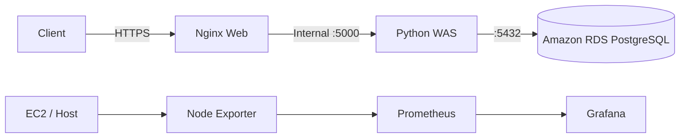
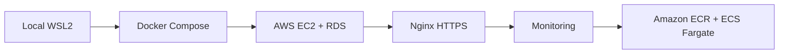

# Project 01. AWS 3-Tier 클라우드 인프라 구축 및 ECS Fargate 확장

> 로컬 Python 애플리케이션을 Docker로 컨테이너화하고, AWS 3-Tier 인프라·HTTPS·모니터링을 구성한 뒤 ECS Fargate까지 확장한 개인 프로젝트입니다.

## Project Context

WSL2에서 실행하던 애플리케이션을 클라우드에서 운영하려면 실행 환경 표준화, Web/WAS/DB 분리, 네트워크 접근 제어, 관측 수단이 필요합니다. 이 프로젝트에서는 다음 순서로 구조를 발전시켰습니다.

WSL2 → Docker → AWS EC2 + RDS 3-Tier → Nginx HTTPS → Prometheus/Grafana → ECR/ECS Fargate

- 문제: 호스트 의존적 실행, 단일 환경에 집중된 구성, 수동 상태 확인
- 선택: Docker Compose, Nginx Reverse Proxy, Amazon RDS, Monitoring Stack, 관리형 컨테이너 실행 환경
- 검증 범위: 컨테이너 실행, 3-Tier 요청 흐름, HTTPS, 모니터링 인터페이스 접근, ECS Service/Task 실행 및 애플리케이션 직접 접근

## Architecture



단계별 고도화



> 위 다이어그램은 프로젝트의 단계별 구성과 역할을 설명합니다. 모든 구성 요소가 최종 ECS 단계에서 동일하게 운영되었다는 의미는 아닙니다.


## 구성도

[클라우드 구성도와 구성 요소 설명](docs/cloud-architecture.md)

## Tech Stack

| 구분 | 기술 | 사용 목적 |
|---|---|---|
| AWS | EC2, RDS PostgreSQL, IAM | 인프라 및 DB 분리, AWS 리소스 접근 |
| Container | Docker, Docker Compose V2 | 실행 환경 표준화 |
| Web | Nginx, HTTPS | Reverse Proxy 및 TLS 처리 |
| Backend | Python HTTPServer, psycopg2-binary | 애플리케이션 및 PostgreSQL 연동 |
| Monitoring | Node Exporter, Prometheus, Grafana | 호스트 지표 수집과 시각화 |
| Container Platform | ECR, ECS Fargate | 이미지 저장 및 관리형 컨테이너 실행 |

## Core Engineering Decisions

| 문제 | 적용한 기술/방법 | 이유 |
|---|---|---|
| 실행 환경에 따른 차이 | Docker / Compose | 배포 및 재현성 개선 |
| WAS 직접 접근 | Nginx Reverse Proxy | 웹 진입점과 내부 애플리케이션 분리 |
| 애플리케이션과 DB의 결합 | Amazon RDS | DB 수명주기·접근 경계 분리 |
| 서버 상태를 수동으로 확인 | Node Exporter + Prometheus + Grafana | 메트릭 기반 관측 환경 마련 |
| EC2 중심 컨테이너 실행 | ECR + ECS Fargate | 레지스트리와 관리형 런타임 분리 |
| AWS 자격 증명 노출 위험 | IAM Role | 코드에 장기 액세스 키 저장 지양 |

## Implementation & Validation

### 1. Web / WAS / DB 분리
- Nginx가 클라이언트의 요청을 받아 내부 Python WAS(`:5000`)로 전달합니다.
- WAS는 환경 변수로 설정한 PostgreSQL에 연결해 날씨 메모를 조회·등록합니다.
- 데이터베이스는 `users`, `weather_logs` 테이블과 JOIN 조회를 사용합니다.

### 2. HTTPS 및 접근 경계
- Nginx에서 HTTP → HTTPS 리다이렉션과 TLS 1.2/1.3을 설정했습니다.
- 검증 환경에서는 자체 서명 인증서를 사용했으므로 브라우저 신뢰 경고가 발생할 수 있습니다.
- 실서비스용 공인 인증서와 로드 밸런서 기반 TLS 종료까지 구현했다고 주장하지 않습니다.

### 3. Monitoring
- Node Exporter 지표를 Prometheus가 5초 간격으로 수집하도록 구성했습니다.
- 모니터링 컨테이너 실행과 Grafana 웹 UI 접근을 확인했습니다.
- 이 프로젝트에서 운영 수준의 SLO, Alerting, 고도화된 대시보드까지 검증했다고 주장하지 않습니다.

### 4. ECR / ECS Fargate
- 애플리케이션 이미지를 ECR에 Push하고 ECS Task Definition / Service를 구성했습니다.
- 검증 당시 Fargate Task 1개, 컨테이너 포트 5000, Public IP를 이용해 직접 접근했습니다.
- ALB, Multi-AZ 고가용성, Auto Scaling은 검증 범위에 포함되지 않습니다.
- 상세 내용: [ECS 배포 기록](docs/ecs-deployment.md)

## Troubleshooting

| 현상 | 원인 | 해결 |
|---|---|---|
| 실행 중인 컨테이너에 외부 요청이 도달하지 않음 | WAS가 컨테이너 내부 `127.0.0.1`에 바인딩 | `0.0.0.0`로 변경 후 재배포 |
| `KeyError: 'ContainerConfig'` | 구형 Docker Compose와 Docker Engine 호환성 문제 | Compose V2 플러그인 사용 |
| PostgreSQL 드라이버 로딩 실패 | 이미지 내 네이티브 빌드 의존성 문제 | `psycopg2-binary` 사용 |

상세 과정: [Troubleshooting](docs/troubleshooting.md)

## Repository Structure

```text
backend/            # Python WAS, Dockerfile, requirements
database/           # SQL schema
nginx/              # Reverse Proxy 설정
monitoring/         # Prometheus 수집 설정
docs/               # ECS 배포 및 트러블슈팅
docker-compose.yml  # 컨테이너 실행 구성
.env.example        # 비밀값을 제외한 환경 변수 예시
README.md
```

## Local Execution

```bash
cp .env.example .env
mkdir -p ssl
openssl req -x509 -nodes -days 365 -newkey rsa:2048 \
  -keyout ssl/nginx.key -out ssl/nginx.crt -subj "/CN=localhost"
docker compose up --build -d
```

`.env`에 DB 연결 정보를 설정해야 합니다. 이 저장소에는 TLS Private Key, 실제 DB 비밀번호와 AWS Credentials를 포함하지 않습니다.

| 서비스 | 포트 |
|---|---|
| Nginx | 80, 443 |
| Python WAS | 컨테이너 내부 5000 |
| Prometheus | 9090 |
| Grafana | 3000 |
| Node Exporter | 컨테이너 내부 9100 |

> 인터넷 공개 환경에서는 Prometheus/Grafana 관리 포트를 전체 인터넷(`0.0.0.0/0`)에 노출하지 않아야 합니다.

## Limitations & Next Step

- 현재 자료는 프로젝트 당시 검증한 내용을 기록하며, 상시 운영 중인 서비스라고 주장하지 않습니다.
- 검증 범위에는 고가용성, Auto Scaling, ALB, 운영용 인증서/권한 최소화 검증이 포함되지 않습니다.
- 다음 단계에서는 외부 AI API와 데이터 흐름에 대한 Secret·접근 통제·장애 격리를 강화했습니다.

Project 01 BUILD → [Project 02 Heimdall — SECURE](https://github.com/Hoit1210/Heimdall-project) → Project 03 OBSERVE & RESPOND → Project 04 AUTOMATE

## Portfolio

[Project 01 Notion Portfolio](https://app.notion.com/p/3af59c94122580ef9a87e99fbef36a77)

> GitHub에는 코드와 구성 파일, Notion에는 설계 배경·검증 화면·문제 해결 과정을 정리합니다.


---

## 구축 및 검증 기록

이 섹션의 항목은 [개인 프로젝트 관리 — Project 01 기록](https://app.notion.com/p/3b559c9412258075949de16542d5b774)에 보관된 단계별 캡처 및 설명을 기반으로 합니다. GitHub에는 구성 코드를, Notion에는 당시의 실행 화면을 보관합니다.

| 단계 | 실제 확인한 내용 | Notion에서 확인할 위치 |
|---|---|---|
| 로컬 웹 환경 | Python WAS 5000 포트 응답 | Architecture Evolution → Phase 1 |
| 컨테이너화 | Nginx와 Python WAS의 Docker Compose 실행 | Phase 2 |
| AWS 3-Tier | 애플리케이션에서 RDS 연결, DB Server Time 조회, 데이터 저장 및 조회 | Phase 3 / Result → Verification |
| HTTPS | 자체 서명 인증서 적용 후 HTTPS Endpoint 접근 | Infrastructure & Security → HTTPS |
| 모니터링 | 5개 컨테이너 실행 및 Grafana 웹 화면 접근 | Phase 4 / Observability |
| 컨테이너 고도화 | ECR 이미지 저장, ECS Service Active / Task 1/1, ECS 애플리케이션 접근 | Phase 5 / Result → Verification |

구성도 해석: 위쪽 3-Tier 다이어그램은 EC2 중심으로 구현한 Web/WAS/RDS 구조이고, ECR → ECS Fargate는 그다음 단계에서 진행한 별도 실행 구조의 확장입니다. 처음부터 ALB 또는 Multi-AZ를 운영한 것으로 해석하지 않습니다.

진행 기간: 2026년 5월~6월 · 개인 프로젝트.
