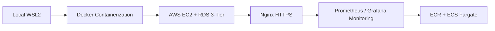
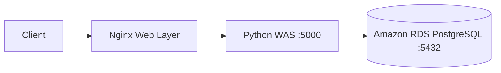
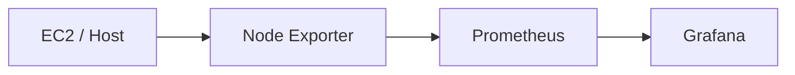

# AWS 3-Tier Cloud Native Infrastructure

Local WSL2 환경에서 시작한 Python 애플리케이션을 Docker 기반으로 컨테이너화하고, AWS 환경에서 Web / WAS / DB 역할을 분리한 3-Tier 구조로 확장한 개인 프로젝트입니다.

이후 Nginx Reverse Proxy와 HTTPS를 적용하고 PostgreSQL을 Amazon RDS로 분리했으며, Node Exporter · Prometheus · Grafana 기반 Monitoring Stack을 추가했습니다. 마지막으로 Container Image를 Amazon ECR에 저장하고 ECS Fargate Service/Task 기반 실행 구조까지 확장했습니다.

> Local WSL2 → Docker → AWS 3-Tier → HTTPS → Monitoring → ECR / ECS Fargate

## Architecture Evolution



### 3-Tier request flow



## Tech Stack

- **AWS**: EC2, RDS PostgreSQL, ECR, ECS Fargate, IAM
- **Container**: Docker, Docker Compose V2
- **Web**: Nginx
- **Backend**: Python `HTTPServer`
- **Database**: PostgreSQL, `psycopg2-binary`
- **Monitoring**: Node Exporter, Prometheus, Grafana
- **Security**: Nginx HTTPS, self-signed certificate for test environment, Security Group, IAM Role

## Repository Structure

```text
.
├── backend/
│   ├── app.py
│   ├── Dockerfile
│   └── requirements.txt
├── database/
│   └── schema.sql
├── docs/
│   ├── ecs-deployment.md
│   └── troubleshooting.md
├── monitoring/
│   └── prometheus.yml
├── nginx/
│   └── nginx.conf
├── .env.example
├── .gitignore
├── docker-compose.yml
└── README.md
```

## Key Engineering Decisions

| Problem | Decision | Purpose |
|---|---|---|
| Host-dependent execution | Docker / Compose | Standardize the application runtime |
| Direct WAS entry point | Nginx Reverse Proxy | Separate web entry point and backend |
| Application / DB coupling | Amazon RDS | Separate the database lifecycle and access boundary |
| Manual server inspection | Node Exporter + Prometheus + Grafana | Build a metrics-based monitoring foundation |
| EC2-centered container operation | ECR + ECS Fargate | Separate image registry from managed container runtime |
| Static AWS credentials risk | IAM Role | Use role-based AWS resource access |

## Application

The backend provides a simple weather memo board backed by PostgreSQL.

Main behaviors:

- Creates `users` and `weather_logs` tables when needed
- Reads weather logs using `JOIN`
- Adds a new weather memo through `/add`
- Connects to PostgreSQL using environment variables
- Listens on `0.0.0.0:5000` for container networking

Database credentials are **not stored in source code**.

## Environment Variables

Copy the example file and fill in your own values.

```bash
cp .env.example .env
```

```env
DB_HOST=<RDS_ENDPOINT>
DB_PORT=5432
DB_NAME=postgres
DB_USER=<DB_USER>
DB_PASSWORD=<DB_PASSWORD>
```

`.env` is excluded through `.gitignore`.

## Run with Docker Compose

This repository intentionally does not include a TLS private key or certificate.

Create a local `ssl/` directory and provide your own test certificate before starting Nginx HTTPS.

```bash
mkdir -p ssl
openssl req -x509 -nodes -days 365 -newkey rsa:2048 \
  -keyout ssl/nginx.key \
  -out ssl/nginx.crt \
  -subj "/CN=localhost"
```

Start the stack:

```bash
docker compose up --build -d
```

Services:

| Service | Port |
|---|---:|
| Nginx | 80 / 443 |
| Python WAS | internal 5000 |
| Prometheus | 9090 |
| Grafana | 3000 |
| Node Exporter | internal 9100 |

> For an Internet-facing production environment, Prometheus and Grafana should not be exposed to `0.0.0.0/0` without additional access controls.

## HTTPS Configuration

Nginx handles HTTP → HTTPS redirection and proxies requests to the internal application service.

The project configuration allows TLS 1.2 and TLS 1.3:

```nginx
ssl_protocols TLSv1.2 TLSv1.3;
```

A self-signed certificate was used for project verification, so browser trust warnings were expected. A production deployment should use a trusted certificate such as AWS ACM where applicable.

## Monitoring



`monitoring/prometheus.yml` configures Prometheus to scrape Node Exporter every 5 seconds.

The retained project evidence verifies that the monitoring containers were running and the Grafana web interface was reachable. This repository does not claim a production-grade dashboard, SLO, or alerting implementation for this project.

## Troubleshooting

Three issues from the actual project are documented in [`docs/troubleshooting.md`](docs/troubleshooting.md):

1. Container port forwarding failure caused by `127.0.0.1` binding
2. `KeyError: 'ContainerConfig'` caused by legacy Docker Compose compatibility
3. PostgreSQL driver dependency issue resolved with `psycopg2-binary`

## ECS Fargate Migration

The final stage pushed the application image to Amazon ECR and ran it through an ECS Fargate Service/Task.

See [`docs/ecs-deployment.md`](docs/ecs-deployment.md) for the sanitized deployment flow and the scope that was actually verified.

## Security Notes

The public repository intentionally excludes:

- AWS Access Key / Secret Access Key
- Database password
- RDS endpoint used in the original environment
- AWS Account ID
- TLS private key
- `.env`
- Public infrastructure identifiers that are not necessary for understanding the implementation

The original project used a self-signed TLS certificate for verification. High availability, Auto Scaling, ALB-based routing, ACM-based TLS termination, and formal least-privilege IAM validation were outside the verified scope of this project.

## Portfolio

Detailed architecture evolution, engineering decisions, troubleshooting, evidence screenshots, results, and the transition to the next project are documented in the Notion portfolio.

[View Project 01 Notion Portfolio](https://app.notion.com/p/3af59c94122580ef9a87e99fbef36a77)
