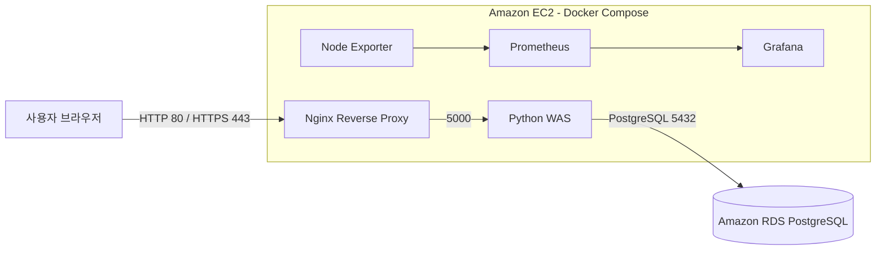
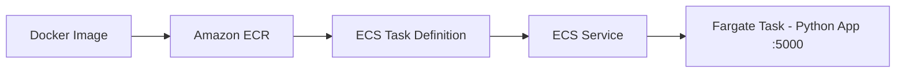

# 아키텍처

이 프로젝트는 하나의 고정된 구성으로 끝난 작업이 아니라, 로컬에서 시작해 AWS로 옮기고 ECS Fargate까지 확장한 과정입니다.

## EC2 기반 3-Tier 구성

Nginx와 WAS는 Docker Compose로 실행했습니다. 데이터베이스는 별도의 Amazon RDS PostgreSQL을 사용했으며, 접근은 Security Group으로 제한했습니다. HTTPS 검증에는 자체 서명 인증서를 사용했습니다.

## ECS Fargate 확장

ECS에서 애플리케이션 컨테이너를 실행하고 직접 접근하는 단계까지 확인했습니다. 이 구성에는 ALB, Auto Scaling, Multi-AZ를 포함하지 않습니다.

## 실제 화면

[프로젝트 진행 기록](https://app.notion.com/p/3b559c9412258075949de16542d5b774)에서 RDS 연결·CRUD, Docker Compose, HTTPS, Grafana, ECR 및 ECS Task 1/1 실행 화면을 볼 수 있습니다.
