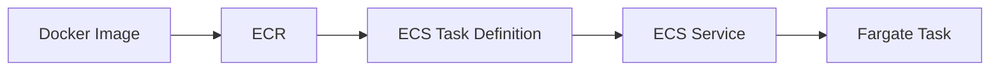

# ECS Fargate 배포

EC2 환경에서 빌드한 Docker 이미지를 ECR에 등록하고 ECS Fargate에서 실행했습니다.

검증 당시 실행 유형은 Fargate, Task Family는 weather-task, 컨테이너 이름은 app, 포트는 5000, Task 수는 1개였습니다. Public IP로 직접 접근했으며 Load Balancer는 사용하지 않았습니다.

EC2의 IAM Role을 이용해 ECR 인증을 진행했습니다.

노션에서 ECR 이미지 등록, ECS Service Active, Task 1/1 및 애플리케이션 응답 화면을 확인할 수 있습니다.

[구축 기록](https://app.notion.com/p/3b559c9412258075949de16542d5b774)

ALB, Multi-AZ, Auto Scaling 및 운영 환경 TLS 처리는 이번 검증에 포함되지 않았습니다.
