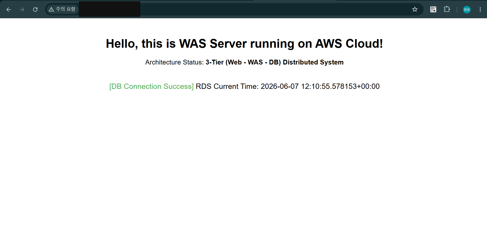
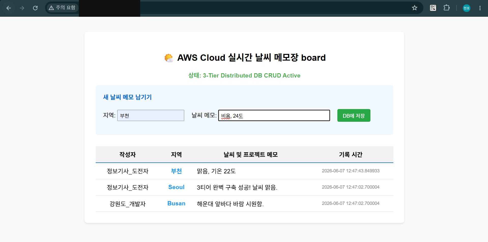
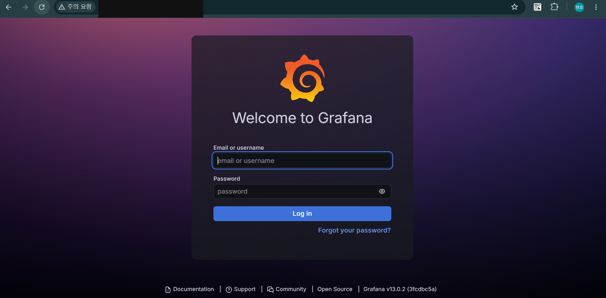
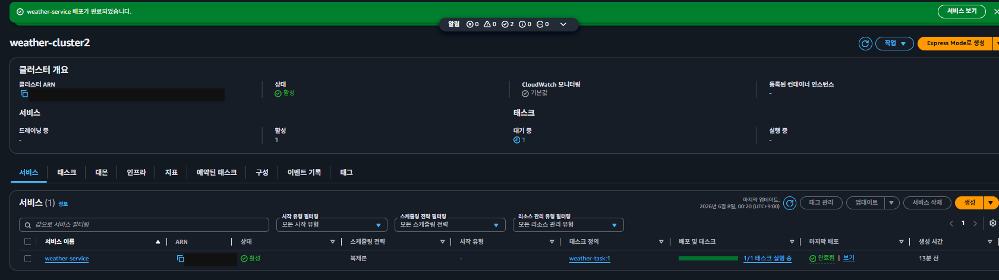
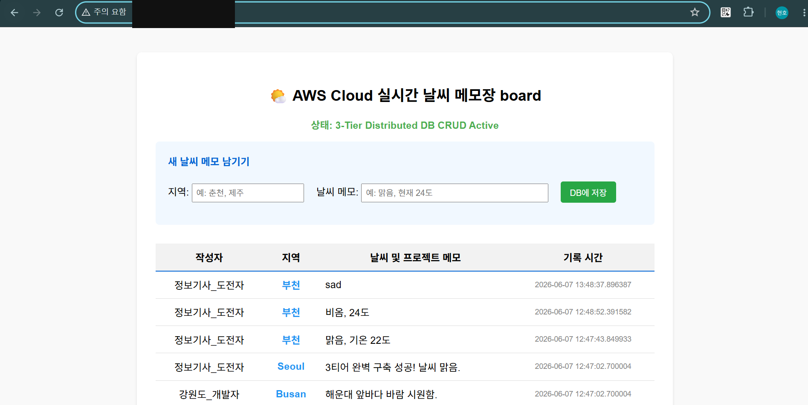

# 구축 및 검증 화면

프로젝트 진행 당시 노션에 보관한 실행 화면입니다. 캡처에서 확인할 수 있는 결과를 중심으로 정리했습니다. 현재 서비스를 다시 실행해 검증한 기록은 아닙니다.

공개용 사본에는 AWS 계정 식별자, 공인 IP, 인증 토큰 등 노출을 피해야 하는 부분을 불투명하게 가렸습니다. localhost·루프백 주소와 문서용 테스트 주소는 유지했습니다.

## RDS PostgreSQL 연결 확인

애플리케이션에 DB 연결 성공과 RDS 서버 시간이 표시됩니다.

## AWS 3-Tier 애플리케이션 동작

날씨 메모 입력 폼과 저장된 목록을 확인했습니다. 화면만으로 모든 CRUD 동작을 검증한 것은 아닙니다.

## Grafana 접속 화면

Grafana 로그인 페이지 접근 화면입니다. 지표 수집이나 대시보드 구성을 입증하는 화면은 아닙니다.

## ECS 서비스 및 Task 실행

ECS 클러스터 활성 상태와 서비스의 Task 1/1 실행 상태를 확인했습니다.

## ECS 환경 애플리케이션 동작

ECS 환경에서 애플리케이션 입력 폼과 메모 목록이 표시되는 것을 확인했습니다.

[프로젝트 설명으로 돌아가기](../README.md)
